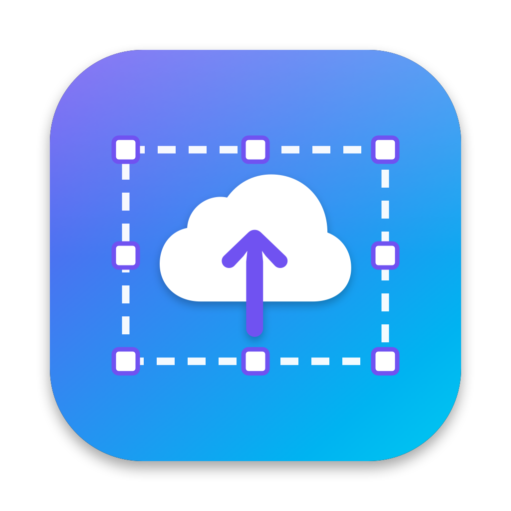
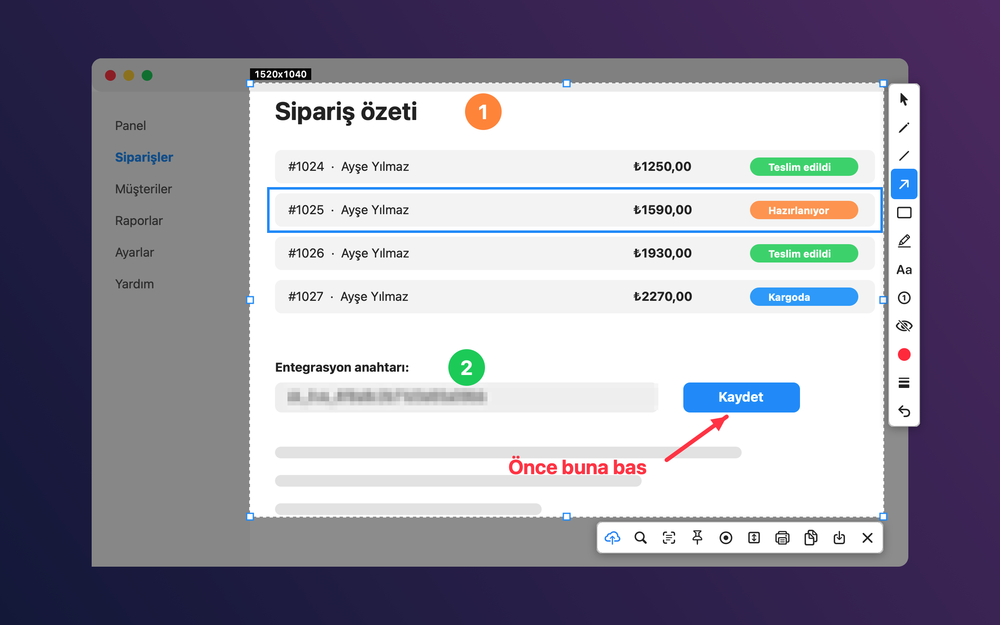
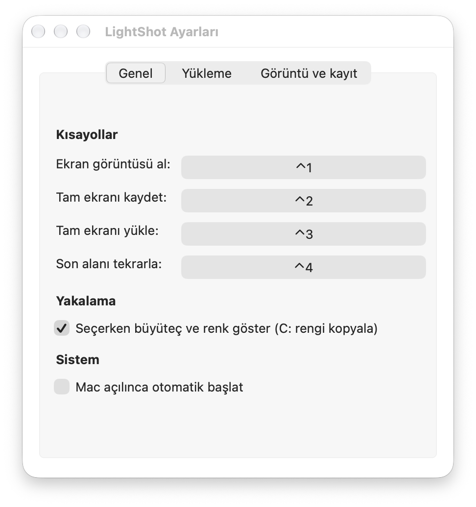
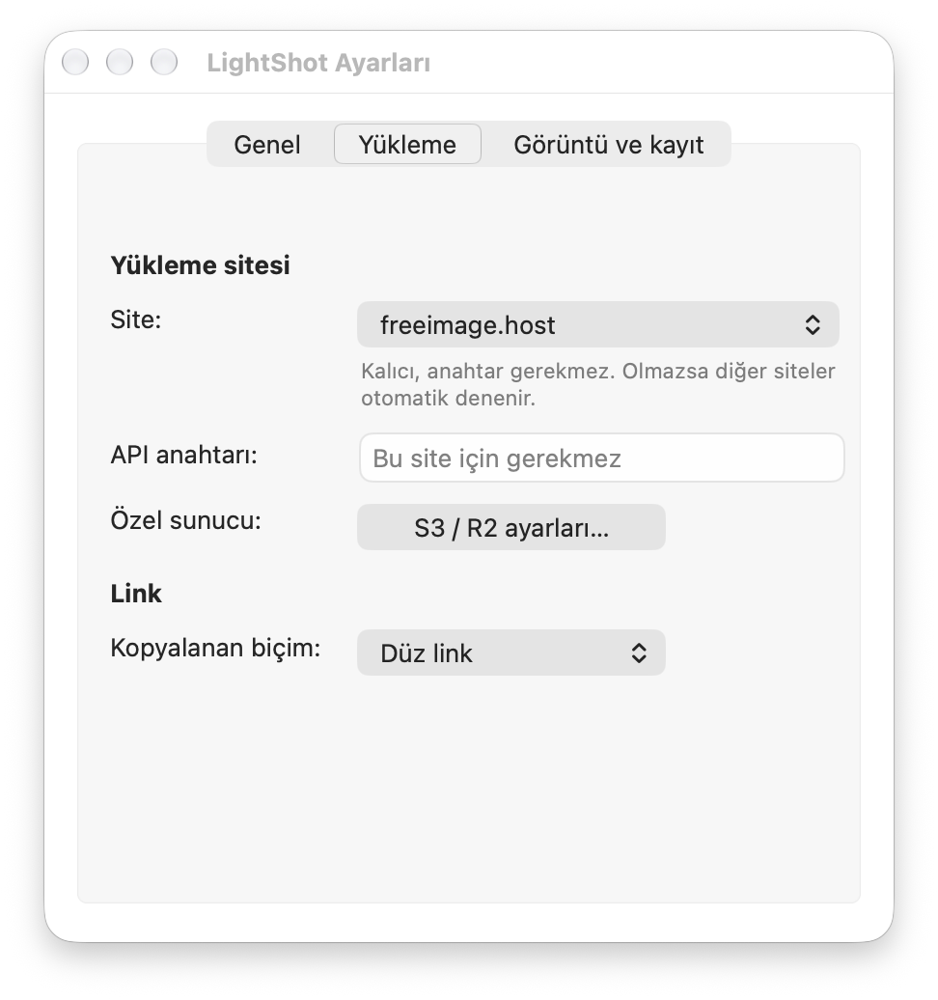
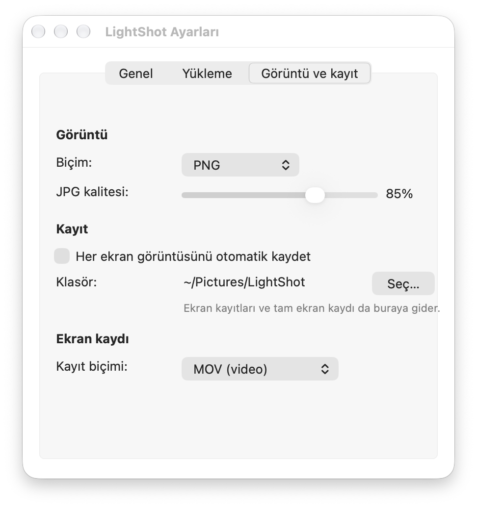
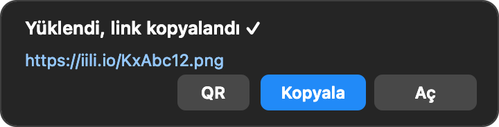

<div align="center">



# LightShotMac

**macOS için hızlı, Lightshot tarzı bir ekran görüntüsü aracı.**
Alan seç, üstüne çiz, yükle. Ya da içindeki yazıyı kopyala, ekrana sabitle, kaydet, uzun bir sayfayı kaydırarak yakala.

[](#gereksinimler)
[](#gereksinimler)
[](https://swift.org)
[](LICENSE)

[English README](README.md)



</div>

## Özellikler

**Yakalama**
- Genel kısayol (varsayılan **⌃1**), **tüm monitörleri** dondurur. Seçimi ekranlar arasında sürükleyebilirsin
- Bir pencerenin üstüne gelip tıklayarak tamamını seç
- Büyüteç ve **renk seçici** (**C** tuşu HEX rengi kopyalar)
- Köşe tutamaçlarıyla boyutlandırma, seçimi taşıma, son alanı tekrarla (**⌃4**), gecikmeli çekim (3 / 5 / 10 sn)
- Tam ekran kısayolları: klasöre kaydet (**⌃2**) ya da yükle (**⌃3**)

**Çizim**
- Kalem, çizgi, ok, dikdörtgen (istersen dolgulu), işaretleyici, metin, **numaralı adım işaretleri**
- Gizli bilgiler için **bulanıklaştırma** aracı
- Çizimleri sonradan seç, taşı, sil. Çizgi kalınlığı, renk paleti, geri al (⌘Z)

**Paylaşma**
- Tek tıkla yükle. Link panoya kopyalanır (düz, Markdown, HTML ya da BBCode) ve **QR kod** gösterilir
- Siteler: freeimage.host, pixhost.to, uguu.se, ImgBB, Imgur ya da **kendi S3 / Cloudflare R2 bucket'ın** (otomatik silme destekli)
- Otomatik yedek: bir site olmazsa sıradaki denenir, yakın zamanda başarısız olan siteler en sona atılır
- Menü çubuğunda yükleme geçmişi, PNG ya da JPG çıktı, Google Lens ile benzer görsel arama, yazdırma

**Ekstralar**
- **OCR**: seçtiğin alandaki yazıyı kopyala (Apple Vision, Türkçe dahil çok dilli)
- **Ekrana sabitle**: görüntüyü diğer pencerelerin üstünde açık tut
- **Kaydırmalı yakalama**: uzun bir web sayfasını ya da belgeyi tek bir uzun görüntüde birleştirir
- Bir alanın **ekran kaydı** (MOV ya da GIF)
- Her yakalamayı klasöre otomatik kaydet, Mac açılınca otomatik başlat

## Ekran görüntüleri

<table>
<tr>
<td></td>
<td></td>
<td></td>
</tr>
</table>

<p align="center"></p>

## Gereksinimler

- macOS **13 Ventura ya da daha yeni**
- **Apple Silicon** (M1 ve üzeri). Derleme betiği `arm64` hedefler, Intel henüz desteklenmiyor
- Xcode Command Line Tools: `xcode-select --install` (tam Xcode gerekmez)

## Derleme ve kurulum

```bash
git clone https://github.com/rpyhub/lightshot-mac-alternative.git
cd lightshot-mac-alternative
./build.sh
open /Applications/LightShot.app
```

`build.sh` uygulamayı derler, imzalar ve `/Applications` içine kopyalar.

**İmza ve izinler.** macOS, *Ekran Kaydı* iznini uygulamanın imzasına bağlar. Betik varsayılan olarak giriş anahtarlığına **"LightShot Local"** adında küçük, kendinden imzalı bir sertifika ekler (güven ayarlarına dokunmaz). Böylece izin **yeniden derlemelerde korunur**. macOS, `codesign`'ın bu anahtarı kullanması için bir kez izin isteyebilir: *Her Zaman İzin Ver*'i seç.
Anahtarlığına dokunulmasını istemezsen: `ADHOC=1 ./build.sh` (bu durumda macOS her yeniden derlemeden sonra Ekran Kaydı iznini tekrar sorar). Sadece derleyip kurmamak için: `NO_INSTALL=1 ./build.sh`.

### İlk çalıştırma

1. **⌃1**'e bas. macOS **Ekran Kaydı** izni ister: *Sistem Ayarları → Gizlilik ve Güvenlik → Ekran Kaydı*'ndan **LightShot**'ı aç, sonra *Çık ve Yeniden Aç*'ı seç.
2. **Kaydırmalı yakalama** ayrıca **Erişilebilirlik** izni ister (sayfayı senin yerine kaydırır). macOS ilk kullanımda sorar.

## Kullanım

| Kısayol | İşlem |
|---|---|
| **⌃1** | Alan yakala (ayarlanabilir) |
| **⌃2** | Tam ekranı klasöre kaydet |
| **⌃3** | Tam ekranı yükle |
| **⌃4** | Son alanı tekrarla |

Yakalama ekranında: **Enter / ⌘D** yükle · **⌘C** kopyala · **⌘S** kaydet · **⌘P** yazdır · **⌘Z** geri al · **Delete** seçili çizimi sil · **C** imlecin altındaki rengi kopyala · **Esc** iptal.

Tüm kısayollar, yükleme sitesi, link biçimi, görüntü biçimi, otomatik kayıt klasörü ve daha fazlası menü çubuğu simgesi → **Ayarlar…** içinde.

## Gizlilik ve güvenlik

- Ekran görüntüleri, sen yükle'ye basana kadar **Mac'inde kalır**. Yüklemeler seçtiğin siteye (başarısız olursa yedek sitelere) gider. Linke sahip olan herkes görüntüyü görebilir.
- **Google Lens araması görüntüyü önce yükler**, çünkü Lens sadece link kabul eder.
- Kaynak koddaki **freeimage.host** anahtarı, o sitenin kendi API sayfasında herkese açık yayınlanan anahtardır. ImgBB / Imgur anahtarları uygulamanın ayarlarında, **S3 gizli anahtarı macOS Anahtarlığı'nda** saklanır.
- Yükleme sitelerinin döndürdüğü linkler sadece `http://` ya da `https://` ile başlıyorsa açılır.
- Başarısız yüklemeler (kimlik bilgisi olmadan) `~/Library/Logs/LightShot.log` dosyasına yazılır, dosya yaklaşık 256 KB'ı geçmez.

## Geliştirme

```bash
./tests/run.sh           # AWS imza örnekleri, kaydırmalı birleştirme, OCR, bellek sızıntısı kontrolü, ...
./scripts/make_icon.sh   # uygulama ikonunu yeniden üret
./scripts/release.sh     # derle, kur ve GitHub sürümü için zip üret (dist/)
```

| Dosya | Ne yapar |
|---|---|
| `main.swift` | Uygulama, kısayollar, ayarlar, yakalama hattı, yükleme siteleri, kayıt |
| `Overlay.swift` | Yakalama ekranı: seçim, çizim araçları, büyüteç, araç çubukları, bildirimler |
| `Features.swift` | OCR, sabitleme, QR, S3/R2 (AWS Signature V4), pencere listesi, GIF, kaydırmalı birleştirme |
| `tests/` | Bağımsız test çalıştırıcısı (test kütüphanesi gerekmez) |

Üçüncü taraf bağımlılık yok, sadece Apple çerçeveleri (AppKit, Vision, CryptoKit, AVFoundation, Carbon).

## Katkıda bulunma

Hata bildirimleri ve pull request'ler memnuniyetle karşılanır. İyi ilk katkılar:
- **Yerelleştirme** (özellikle İngilizce arayüz metinleri)
- Intel / universal derleme
- ScreenCaptureKit ile yakalama (daha hızlı, ama macOS 15+ tekrarlayan izin uyarısına bak)
- Noter onaylı (notarized) sürümler

Pull request açmadan önce lütfen `./tests/run.sh` çalıştır.

## Sorumluluk reddi

LightShotMac bağımsız bir açık kaynak projedir. **Lightshot ya da Skillbrains ile bağlantısı, onayı ya da ortaklığı yoktur.** "Lightshot" ilgili sahibinin ticari markasıdır. Buradaki ad yalnızca ilham alınan kullanım şeklini tarif eder.

## Lisans

[MIT](LICENSE)
